# courier-emu architecture

This is the current standalone analog Courier/SIP path. The captured CPU
firmware parses commands and controls the modem; the DSP firmware generates
and consumes modem waveforms. The emulator supplies their processors and
surrounding board hardware.

```mermaid
flowchart LR
    App["Terminal / application<br/>or DECserver"]
    Launch["run.sh / CLI<br/>configuration + firmware"]
    Network["PBX / SIP peer<br/>remote modem"]

    subgraph Worker["Analog Courier worker process"]
        Serial["PTY / serialsim<br/>console transport"]
        CPU["80186 CPU<br/>supervisor firmware"]
        Memory["CPU RAM + flash<br/>interrupt vectors"]
        Devices["UART + DTE pins<br/>timers, IRQs, GPIO, EEPROM"]
        Bridge["ASIC / DSP host interface<br/>mailboxes + data lanes"]
        DSP["C5x DSP<br/>modem firmware"]
        DSPMemory["DSP program + data memory<br/>boot ROM + downloaded code"]
        Audio["Codec + resampling<br/>DAA + line exchange"]
        SIP["Virtual ATA adapter<br/>SIP + G.711 RTP"]
        Scheduler["Board clocks + deadlines<br/>Python services / native worker poll"]

        Serial <-->|bytes + modem signals| Devices
        Devices <-->|ports / MMIO / interrupts| CPU
        CPU <--> Memory
        CPU <-->|commands + modem data| Bridge
        Bridge <--> DSP
        DSP <--> DSPMemory
        DSP <-->|PCM samples + codec control| Audio
        Devices -.->|hook / relay state| Audio
        Audio <-->|line audio + call state| SIP
        Scheduler -.-> CPU
        Scheduler -.-> DSP
        Scheduler -.-> Devices
        SIP -.->|wall-clock media pacing| Scheduler
    end

    App <--> Serial
    Launch -->|starts and configures| Worker
    SIP <-->|UDP signalling + RTP audio| Network

    classDef python fill:#e8f1ff,stroke:#476b9c,color:#111;
    classDef native fill:#e5f5e8,stroke:#468252,color:#111;
    classDef mixed fill:#fff1d6,stroke:#a87a24,color:#111;
    classDef external fill:#f2f2f2,stroke:#777,color:#111;
    class Serial,SIP,Launch python;
    class DSP,DSPMemory,Memory native;
    class CPU,Devices,Bridge,Audio,Scheduler mixed;
    class App,Network external;
```



Blue boxes are Python; green boxes are native execution/storage; amber
boxes cross the Python/C++ boundary. CPU memory is a Python-owned bytearray
that C++ accesses directly; its green color describes the ordinary execution
path, not allocation ownership. Solid arrows carry data or register accesses;
dotted arrows show control and scheduling relationships.

## Two firmware processors, one worker

The CPU and DSP are simulated processors inside the same worker process.
They normally execute synchronously on its emulation thread. CPU/DSP calls
are function calls and shared memory accesses, not messages between two OS
processes. SIP can additionally use a helper thread to pace RTP transmission.

The default x86 backend interprets instructions in compiled C++; unsupported
instructions and guarded accesses can fall back to the Python interpreter.
There is no JIT in this default path. An optional Unicorn CPU backend is a
separate execution choice. The C5x interpreter and its program/data memories
are native C++.

The CPU and DSP have distinct address spaces. The CPU does not directly
execute the DSP program or share all of its RAM. Firmware communicates through
the modeled ASIC host interface: loader strobes, mailbox messages, status
bits and byte lanes. During boot the CPU can download DSP code through that
interface; the DSP also has its modeled boot ROM.

## Control and audio paths

The command/data path is:

```text
Application bytes ↔ serial transport ↔ UART/pins ↔ CPU firmware
                                                   ↕
                                           ASIC host interface
                                                   ↕
                                              DSP firmware
```

The modem waveform path is:

```text
DSP ↔ codec/sample model ↔ rate conversion ↔ modeled line/exchange
                                                ↕
                                      virtual ATA / SIP adapter
                                                ↕
                                           G.711 RTP peer
```

The x86 CPU is not in the per-sample audio path. It controls the call and
exchanges modem data/status with the DSP. On the normal exchange/SIP path,
the line model observes hook state and decodes actual dialing audio; the ATA
adapter maps that to SIP call control. SIP answer and firmware modem carrier
are separate events.

Codec operations and FIR conversion have native paths. Python still
coordinates complete line frames, exchange behavior, SIP/RTP and some device
work. Grouping these in one audio box does not imply they are all native.

## What runs between Python services

```mermaid
sequenceDiagram
    participant P as Python board services
    participant X as C++ x86 engine
    participant N as Native devices / worker poll
    participant D as C++ DSP core
    P->>X: Run a bounded instruction batch
    loop While native guards and deadlines permit
        X->>N: Device access or scheduled service
        opt DSP service is due and eligible
            N->>D: Advance owed DSP cycles
            D-->>N: Samples, mailbox and codec state
        end
        opt Timer poll is due
            N->>N: Advance shared counters and latch/deliver requests
        end
        N-->>X: Register result, clocks or interrupt entry
    end
    X-->>P: Python-owned work, watched access or deadline
    P->>P: UART/input, register programming, full frame, SIP or diagnostics
    P->>X: Prepare or safely reuse the native snapshot; resume
```

Native port models, timer reads, counter expiry/request delivery, interrupt
entry, board ticks, deferred INT0/INT1 delivery and eligible DSP/resampling
services can remain inside the C++ batch. Empty plain-terminal readiness
polls and SIP pacing checks that require no wait can also stay native;
input, terminal work and positive media lead return to Python. The counters, mask bits and timer
request queue use one permanent native-layout buffer with live Python views;
there is no per-batch timer snapshot or counter publication step. Register
programming and calibrated-delay grants retain Python logic on those fields.
UART work, complete media frames and other device transitions still require
Python. Other CPU/DSP/line attributes still cross snapshot boundaries, so
moving an individual callback to C++ does not eliminate all arming cost.

Watched memory also supports diagnostics. A watched access can stop native
execution even when it changes only a trace. The worker currently reuses its
snapshot after proven diagnostic-only writes, while functional device work
requires ordinary service/arming. Tests compare the native paths with Python
reference paths to check timing, memory, registers and device state.

## Other configurations

- A socket line (`LineLink`) can connect two modem workers instead of using
  the SIP path. Paired runs have two emulation processes.
- The I-modem uses `IsdnMachine`: a 386EX CPU, DSP/mailbox interface, ISDN
  DSC/B-channel model, timers and interrupt controllers. It shares the native
  interpreter infrastructure but has a different board/device model.
- Recovery loaders, Quad-board harnesses and analysis tools are additional
  entry points around the reusable CPU/DSP machinery. They are not all part
  of the normal analog403 SIP runtime.
- Tests, probes, traces, PCM recordings and diagnostic reports observe the
  emulated processors and devices; they are separate from the modem's guest
  command/data protocol.

## Source map

| Responsibility | Main files |
| --- | --- |
| Configuration and worker launch | [runtime.py](../courier_emu/runtime.py), [cli.py](../courier_emu/cli.py), [worker.py](../courier_emu/worker.py) |
| Analog board and Python services | [machine.py](../courier_emu/machine.py) |
| x86 native execution and fallback | [x86_interpreter.cpp](../native/x86_interpreter.cpp), [x86_native.py](../courier_emu/x86_native.py), [x86_interpreter.py](../courier_emu/x86_interpreter.py) |
| Native worker scheduling | [worker_poll.py](../courier_emu/worker_poll.py), [c5x_capi.cpp](../native/c5x_capi.cpp) |
| ASIC/DSP bridge and DSP execution | [bridge.py](../courier_emu/bridge.py), [dsp.py](../courier_emu/dsp.py), [c5x_core.cpp](../native/c5x_core.cpp) |
| Timer state and reference model | [timers186.hpp](../native/timers186.hpp), [timers_native.py](../courier_emu/timers_native.py), [timers.py](../courier_emu/timers.py) |
| Other board devices | [uart.py](../courier_emu/uart.py), [nvram.py](../courier_emu/nvram.py), [panel.py](../courier_emu/panel.py) |
| Line and audio | [codec.py](../courier_emu/codec.py), [daa.py](../courier_emu/daa.py), [exchange.py](../courier_emu/exchange.py), [resample.py](../courier_emu/resample.py), [resample.hpp](../native/resample.hpp) |
| Virtual ATA and SIP/RTP | [ata.py](../courier_emu/ata.py), [sip.py](../courier_emu/sip.py) |
| Socket line and I-modem variants | [line.py](../courier_emu/line.py), [isdn.py](../courier_emu/isdn.py), [imodem_dsp.py](../courier_emu/imodem_dsp.py) |

Measured boundary costs and migration results are recorded in
[standalone performance](standalone-performance.md).
